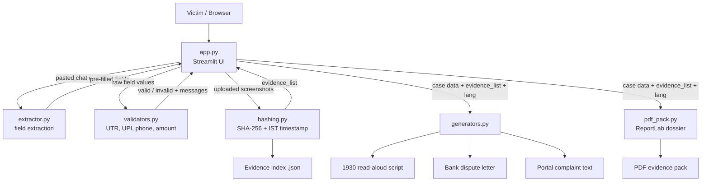

# FraudFirstAid
# 🛡️ FraudFirstAid

**An emergency first-aid kit for victims of online financial fraud in India.**
From panic to a complete evidence pack in about 3 minutes.

> Built by **Team FireHawks** for the Hacktoberfest '26 Hack Day (Abhyudaya Club),
> GL Bajaj Institute of Technology and Management.

---

## Table of contents

1. [The problem](#the-problem)
2. [What FraudFirstAid does](#what-fraudfirstaid-does)
3. [Features](#features)
4. [How it works](#how-it-works)
5. [Architecture](#architecture)
6. [Project structure](#project-structure)
7. [Data model](#data-model)
8. [Key design decisions](#key-design-decisions)
9. [Tech stack](#tech-stack)
10. [Getting started](#getting-started)
11. [Using the app](#using-the-app)
12. [Testing](#testing)
13. [Privacy and security](#privacy-and-security)
14. [Limitations and honest claims](#limitations-and-honest-claims)
15. [Roadmap](#roadmap)
16. [Team FireHawks](#team-firehawks)
17. [Contributing](#contributing)
18. [Emergency contacts (India)](#emergency-contacts-india)

---

## The problem

Most scam tools try to stop a payment *before* it happens. Very little exists for the
minutes **after** the money is gone, when the victim is panicking and does not know what
to say, what to collect, or whom to call.

- **Panic:** the victim is stressed and unsure what to do first, while time matters.
- **Missing details:** the 1930 helpline, the bank and cybercrime.gov.in each need exact
  details: UTR, UPI ID, amount, date and time, screenshots.
- **Scattered proof:** chats, screenshots and links sit across apps, and scammers often
  delete chats and block the victim.

## What FraudFirstAid does

FraudFirstAid is a guided toolkit that turns a few details and some screenshots into a
complete, ready-to-use **fraud response pack**:

| Output | What it is for |
|---|---|
| 📞 **1930 read-aloud script** | Keep it open while you dial 1930 and read it line by line. The UTR is also spelled digit by digit. |
| 🏦 **Bank dispute / chargeback letter** | A formal letter citing the RBI customer-liability circular, with branch, email and evidence annexures. |
| 🌐 **cybercrime.gov.in complaint text** | Structured text you can paste into the National Cyber Crime Reporting Portal. |
| 📦 **PDF evidence pack (dossier)** | A printable bundle of the case details and the hashed evidence index. |
| 🔐 **Evidence index (.json)** | SHA-256 hash and intake timestamp for every uploaded file. |

Everything is available in **English and Hindi**. UTR numbers, UPI IDs and amounts are
never translated.

## Features

- **Smart intake:** paste a scam chat or SMS and click *Extract details* to auto-fill
  amount, UPI ID, UTR, phone and links.
- **Live validation:** the 12-digit UTR, UPI ID, phone number and amount are checked as
  you type, so mistakes are caught before they reach the bank or police.
- **Scam-type aware:** guided flows for fake job offers, KYC, investment scams and more.
- **Tamper-evident evidence:** every uploaded screenshot gets a SHA-256 fingerprint and an
  intake timestamp (IST). Change a file later and its hash no longer matches.
- **Verify Evidence tab:** re-upload a file to check it against the recorded hash.
- **Time-aware 1930 script:** urgent wording (such as the "Golden Hour" freeze request) is
  used only if the incident is under 3 hours old. Older incidents get calm, accurate
  wording that does not claim the fraud is ongoing.
- **Bilingual:** English and Hindi output for the script, letter and portal text.
- **Quick Demo:** one click loads a realistic fictional case for testing.
- **Local-first:** no API keys, no cloud, no database.

## How it works

```
1. Paste        2. Confirm          3. Seal evidence        4. Act
scam chat/SMS → validated fields → screenshots hashed   → script, letter,
(auto-fill)      (UTR, UPI, ₹)      with SHA-256 + time     portal text, PDF
```

1. **Step 1, Intake:** enter details manually or paste the scam message and extract them.
2. **Step 2, Incident and transaction details:** confirm the validated fields (name, bank,
   branch, email, phone, date and time, amount, UTR, UPI ID, description).
3. **Step 3, Screenshot evidence:** upload PNG, JPG, JPEG, WEBP or PDF files. Each one is
   hashed and timestamped on intake.
4. **Step 4, Emergency first-aid outputs:** review and download the 1930 script, bank
   letter, portal text and PDF dossier.

## Architecture

FraudFirstAid is a single Python application with a thin UI layer and independent,
testable modules behind it. There is no server-side state and no network dependency.



### Request flow

1. The user fills the form in **`app.py`** (or pastes a message and runs **`extractor.py`**).
2. **`validators.py`** checks each field and the UI shows live feedback.
3. Uploaded files pass through **`hashing.py`**, which returns an `evidence_list`
   (filename, size, SHA-256, timestamp).
4. When the user asks for outputs, `app.py` passes the case data, the `evidence_list` and
   the chosen language (`lang="en"` or `"hi"`) to **`generators.py`** and **`pdf_pack.py`**.
5. The generators return plain text. `pdf_pack.py` returns a PDF. Both are shown and offered
   for download.

### Module responsibilities

| Module | Responsibility |
|---|---|
| `app.py` | Streamlit UI: steps, language selector, demo data, tabs and downloads. Calls every other module. |
| `validators.py` | Pure functions that validate UTR (12 digits), UPI ID format, Indian mobile number and amount. |
| `hashing.py` | Computes SHA-256 for uploaded files, records the intake timestamp and builds the evidence index. |
| `extractor.py` | Pulls amount, UPI ID, UTR, phone numbers and links out of pasted chat or SMS text. |
| `generators.py` | Produces the 1930 script, bank dispute letter and portal text in English and Hindi. |
| `pdf_pack.py` | Builds the printable PDF dossier with ReportLab. |
| `test_extractor.py` | Tests for the extractor. |

## Project structure

```
FraudFirstAid/
├── app.py              # Streamlit UI (entry point)
├── generators.py       # 1930 script, bank letter, portal text (en/hi)
├── extractor.py        # field extraction from pasted text
├── hashing.py          # SHA-256 + timestamp for evidence files
├── validators.py       # UTR / UPI / phone / amount validation
├── pdf_pack.py         # PDF evidence dossier (ReportLab)
├── test_extractor.py   # tests
├── requirements.txt    # Python dependencies
├── .gitignore
└── README.md
```

## Data model

The UI builds one **case data** dictionary and one **evidence list**, and every generator
takes the same inputs.

```python
case_data = {
    "name": "Full name as per bank account",
    "phone": "10-digit mobile number",
    "bank_name": "State Bank of India (SBI)",
    "branch": "Optional branch / city",      # falls back to a placeholder if empty
    "email": "optional@example.com",          # falls back to a placeholder if empty
    "datetime": "2026-10-24 13:22:00",        # incident date and time
    "amount": 47500.00,
    "utr": "428719043215",                    # 12 digits
    "upi_id": "fraudster@ybl",
    "scam_type": "Fake job offer",
    "scam_specifics": {"...": "scam-type specific answers"},
    "description": "Short sequence of events",
}

evidence_list = [
    {"filename": "Screenshot (1).png", "sha256": "<64 hex chars>", "timestamp": "2026-10-24 13:41:18 IST"},
]
```

Generator signatures:

```python
generate_1930_script(case_data, evidence_list, lang="en")
generate_bank_dispute_letter(case_data, evidence_list, lang="en")
generate_cybercrime_portal_text(case_data, evidence_list, lang="en")
```

`lang` accepts `"en"` or `"hi"`; anything else falls back to English.

## Key design decisions

- **No API keys, no cloud.** A victim's name, bank, UTR and UPI ID never leave their
  device, the app works on a weak connection, and there is nothing to bill, revoke or leak.
- **Template-based output, not generative AI.** Legal-style text must be accurate and
  repeatable. Templates cannot invent a UTR or a legal reference.
- **Time-aware wording.** The 1930 script computes the hours since the incident. Under
  3 hours it asks for an urgent freeze. After that it states plainly that the money has left
  and asks for the beneficiary account to be flagged and any remaining funds held. If the
  time cannot be read, it uses the safe wording.
- **Graceful fallbacks.** Missing `branch` or `email` use the old placeholders. Missing
  fields never crash a generator.
- **Separation of concerns.** UI, validation, hashing, extraction and document generation
  live in separate files, so they can be developed, tested and replaced independently
  (for example, swapping Streamlit for a mobile or WhatsApp front end).
- **Hindi keeps identifiers intact.** Only the surrounding text is translated. UTR, UPI IDs
  and amounts stay exactly as entered so they match bank records.

## Tech stack

| Layer | Technology |
|---|---|
| Language | Python 3 |
| UI | [Streamlit](https://streamlit.io) |
| Evidence integrity | `hashlib` (SHA-256), Python `datetime` |
| PDF generation | [ReportLab](https://www.reportlab.com) |
| Document generation | Plain Python templates (English and Hindi) |
| Version control | Git and GitHub |

## Getting started

### Prerequisites

- Python 3.10 or newer
- `pip`

### Install and run

```bash
git clone https://github.com/arunitD/FraudFirstAid.git
cd FraudFirstAid
pip install -r requirements.txt
python -m streamlit run app.py
```

The app opens at <http://localhost:8501>.

> On Windows, if `streamlit` is "not recognized", use `python -m streamlit run app.py`
> as shown above.

### Try it quickly

Click **Load Demo Data** in the sidebar to fill in a realistic fictional case, then open
Step 4 to see all outputs. Switch **Output language** to Hindi to see the Hindi versions.

## Using the app

1. (Optional) Paste the scam chat or SMS into **Auto-fill** and click **Extract details**.
2. Fill in or correct the details. Green checks confirm a valid UTR and UPI ID.
3. Upload screenshots. Note the SHA-256 table that appears.
4. Open the tabs in Step 4:
   - **1930 Helpline Read-Aloud Script**
   - **Bank Dispute / Chargeback Letter**
   - **cybercrime.gov.in Complaint Text**
   - **PDF Evidence Pack (Dossier)**
   - **Verify Evidence**
5. Download what you need. Call **1930** first if the incident is recent.

## Testing

```bash
python -m pytest test_extractor.py
```

Install `pytest` first if needed (`pip install pytest`). When you add or change generator
logic, also run a quick manual check in both languages with an incident under 3 hours old
and one older than 3 hours.

## Privacy and security

- Everything runs **locally**. There is no database and no external API call in the core flow.
- Evidence files are processed in memory for hashing and are not uploaded anywhere by the app.
- **Never commit secrets.** If an optional API-based feature is added later, keep keys in
  environment variables and out of the repository. This repository is public.
- Use only fictional data in screenshots, demos and tests.

## Limitations and honest claims

- FraudFirstAid is a **documentation aid**. It is **not legal advice** and does not replace
  the helpline, the bank or the police.
- It **prepares** what you say and paste. It does **not** file complaints, freeze accounts or
  promise recovery of money.
- SHA-256 hashes are **tamper-evident, not proof of authenticity.** They show that a file has
  not changed since intake. They do not prove that a screenshot was genuine to begin with, and
  the timestamp comes from the device clock.
- Template-based output cannot interpret free-form stories the way a language model could.
- Hindi text should be reviewed by a fluent speaker before real-world use.
- The project is a hackathon prototype built to be extended, not a production service.

## Roadmap

| Now | Next | Later |
|---|---|---|
| MVP evidence pack in English and Hindi | More Indian languages and bank-specific templates | Portal field mapping, mobile / WhatsApp front end |
| Validated intake, hashed evidence, PDF dossier | Optional OCR for screenshots | Optional, opt-in AI drafting with no victim data stored |

## Team FireHawks

**Team name:** FireHawks
**Institution:** GL Bajaj Institute of Technology and Management
**Event:** Hacktoberfest '26 Hack Day, organised by Abhyudaya Club

| Member | Branch |
|---|---|
| **Anshika Sharma** | Computer Science (AI) |
| **Arunit Dangwal** | Computer Science (AI) |
| **Gargi Tomar** | Computer Science (AI) |

## Contributing

Contributions are welcome, in the spirit of Hacktoberfest.

1. Fork the repository and create a branch (`git checkout -b feature/your-feature`).
2. Make your change. Keep each module focused on its own responsibility.
3. Run the app and the tests locally.
4. Commit with a short, clear message and open a pull request.

Good first contributions: new scam-type flows, more language templates, bank-specific letter
formats, better extraction patterns, and accessibility improvements.

## Emergency contacts (India)

| Service | Contact |
|---|---|
| National Cyber Crime Helpline (financial fraud) | **1930** |
| National Cyber Crime Reporting Portal | <https://cybercrime.gov.in> |
| Emergency services | **112** |

> **If you have just lost money to a scam, call 1930 now, then contact your bank.**
> Report as early as you can.

---

*FraudFirstAid is a student project and is provided as is, without any warranty.*
